# Git 演練作業：依教學影片

本次使用課程的 **DB-Basic Example／FastAPI 範例**，依三支影片重新完成本機版本控制及 GitHub 遠端同步演練，附 **13 張真實操作截圖**。實際操作日期為 2026-10-30，所有提交保留實際時間。操作由使用者授權的助理在使用者電腦執行，發布至使用者登入的 GitHub 帳號。

## 教材與實作對照

| 教材 | 本次完成內容 |
| --- | --- |
| `Git概念介紹.mp4`（18:20） | 工作目錄、暫存區、本機與遠端版本庫；每次提交聚焦一項變更並附說明 |
| `gitLocalRepo演練.mp4`（34:44） | init、uv 環境、FastAPI 範例、gitignore、add、兩次 commit、lg、diff、checkout |
| `gitRemote演練.mp4`（26:32） | 先建立 public repo，再 clone；commit → pull → push；第二個目錄模擬 User A，刪除 SQL、保留另一副本未提交的說明檔修改，來回同步及比較兩個 commit |


## 本機 Git 演練

1. 建立獨立的本機 repository：`git init -b main .`，設定 `lg` 別名。
2. 使用 `uv init` 建立 Python 專案，安裝 `fastapi[standard]`、`python-multipart`、`itsdangerous` 及 `psycopg[binary,pool]`。
3. 將課程範例放入 `src/prj`，設定 `.gitignore` 排除虛擬環境、快取及環境設定。
4. 實際啟動 `uv run fastapi dev routerUse.py`，測試首頁及 `/rou/test`，兩者均回應 HTTP 200。
5. `git add .`、檢查暫存內容、提交初始版本；修改 `0.readme.txt` 後提交第二版。
6. 使用 `git lg` 及 `git diff <第一版> HEAD` 查看歷程與實際內容差異；另示範刪除一行後的未提交差異。
7. 還原暫時修改後，`git checkout <第一版>` 確認修訂文字不存在，再 `git checkout main` 確認修訂文字存在。

本機演練與遠端演練使用不同的 Git repository，與影片的兩種情境相對應。本機的完整提交物件另存為 [local-practice.bundle](evidence/local-practice.bundle)，可還原查看，不只保留截圖。

```powershell
git clone evidence/local-practice.bundle local-practice-replay
git -C local-practice-replay log --oneline --all
```

## GitHub 遠端演練

1. 在 `cxie973-cyber` 帳號建立全新的 public repository，使用 Python 的 `.gitignore` 範本。
2. **先從 GitHub clone** 到本機，再將課程程式、`pyproject.toml` 與 `uv.lock` 放入，提交 `1.0`，執行 pull 與 push。
3. 在 `userA` 的另一個目錄 clone 同一個專案，模擬第二個工作端。
4. 原副本先修改 `0.readme.txt`：移除一行、加入影片中的測試文字，暫不提交。
5. User A 刪除 `students.sql`，提交 `delete sql`，pull 後 push。
6. 原副本 pull，確認 `students.sql` 由存在變成不存在；以修改前後的 SHA-256 相等確認未提交的說明檔內容完整保留。
7. 原副本提交 `update readme`，pull 後 push；User A 再次 pull，檢查歷程、比較兩個版本的說明檔差異，確認工作目錄乾淨。

兩份副本由同一個帳號操作，用來模擬影片中的兩個使用者，沒有宣稱另一位協作者實際參與。

`students.sql` 最後不存在是演練中刻意刪除的結果；可在 `1.0` 的歷史提交及本機 bundle 找到刪除前的版本。

## 真實操作截圖

以下均直接擷取實際執行中的 Windows 終端機視窗，沒有重繪、替換命令輸出或將教材畫面充當操作證據。

### 01｜uv 套件安裝及課程原始碼

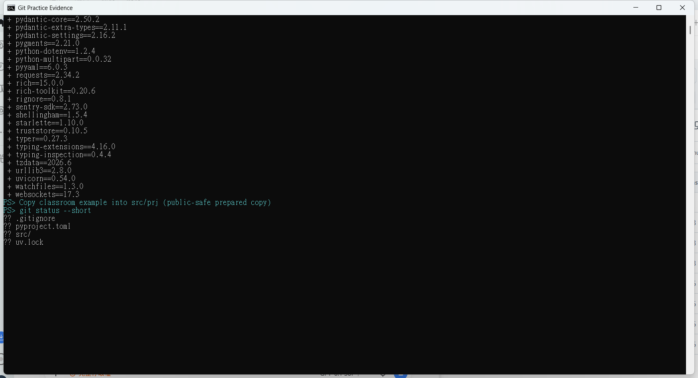

### 02｜啟動 FastAPI，HTTP 測試成功

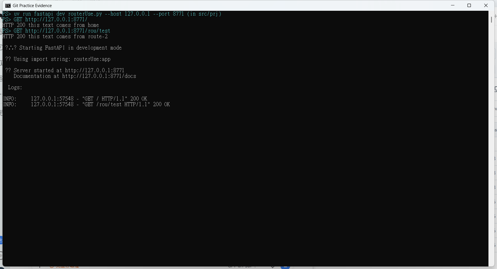

### 03｜加入暫存區及首次提交

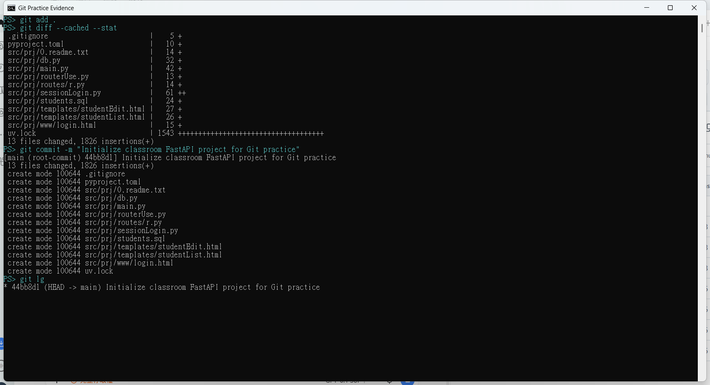

### 04｜第二版、提交歷史與版本差異

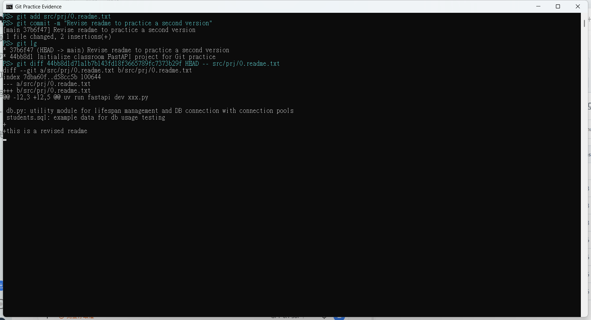

### 05｜刪除一行後的未提交差異

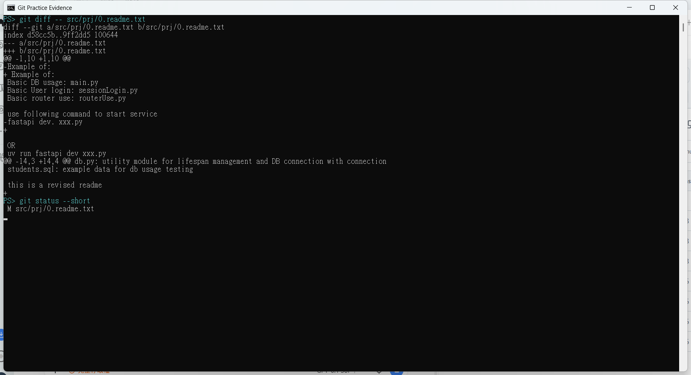

### 06｜checkout 舊版並返回 main

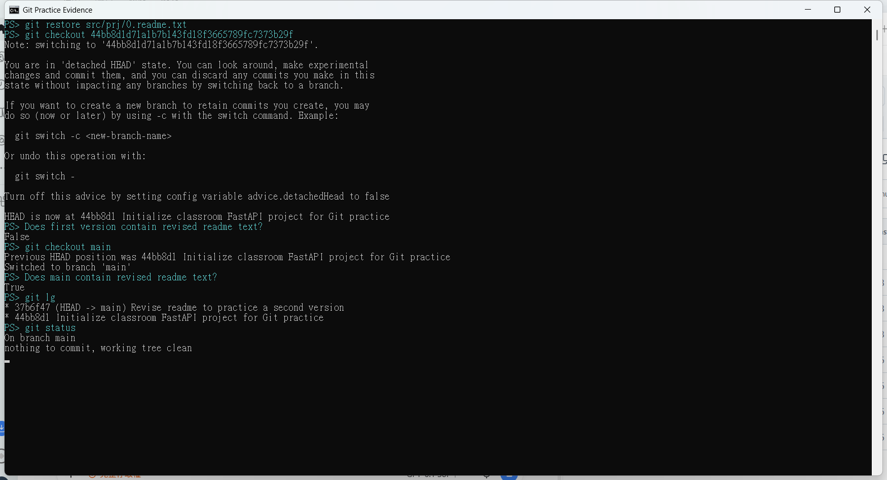

### 07｜建立全新 public repo，再 clone

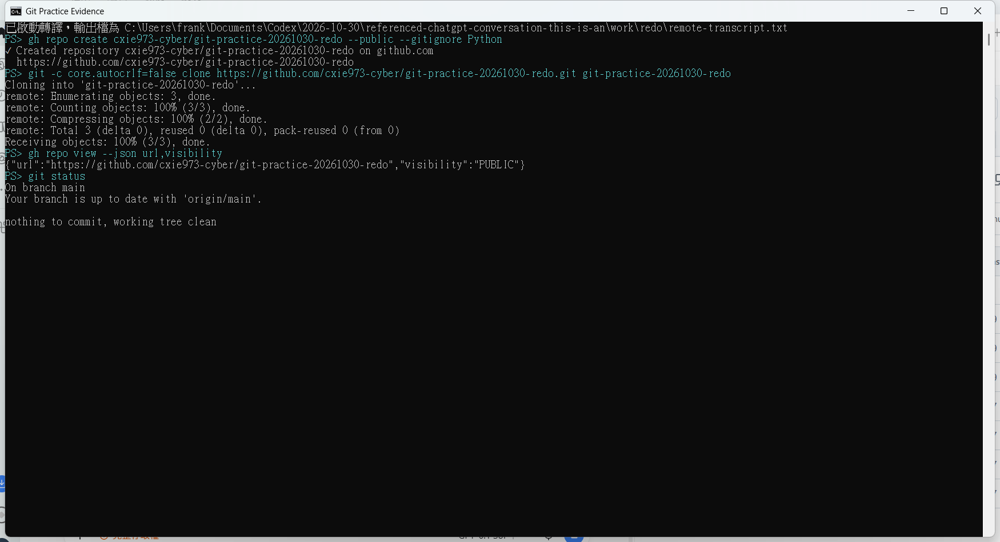

### 08｜初始版本提交、pull 與 push

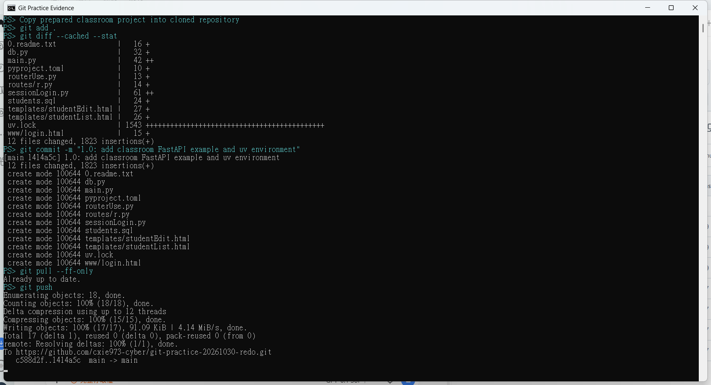

### 09｜User A 的第二份 clone

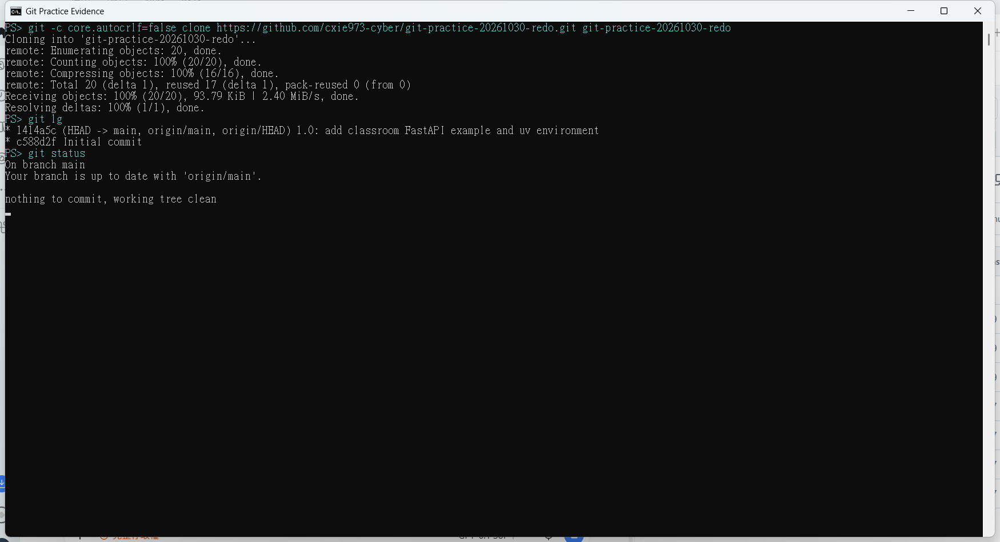

### 10｜User A 刪除 students.sql 並推送

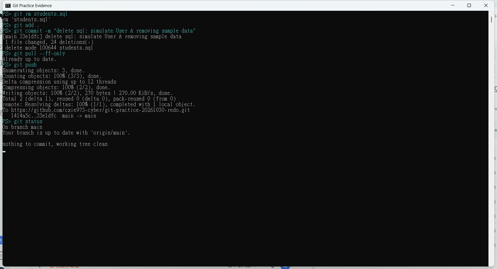

### 11｜原副本 pull，保留未提交修改

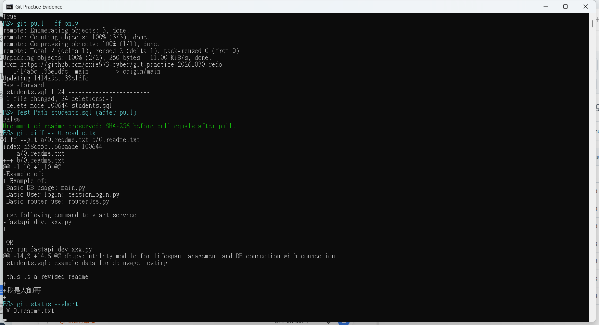

### 12｜原副本提交說明檔、pull 與 push

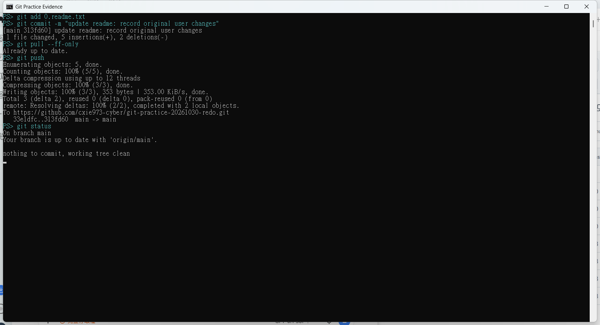

### 13｜User A 再 pull、比較兩個 commit

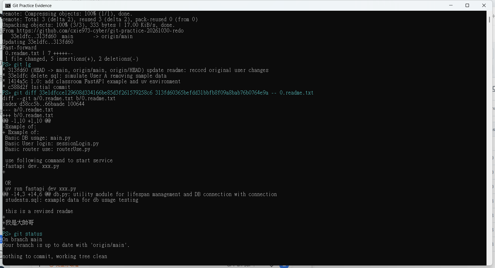

## 程式來源與公開版本調整

程式取自電腦上與影片檔名相符的 `DB-Basic Example`，保留 `db.py`、`main.py`、`routerUse.py`、`sessionLogin.py`、`routes/r.py`、templates、www 及演練前的 `students.sql`。

- 將範例中的資料庫連線與登入設定改用環境變數；SQL 的學生列改為明確的虛構示範資料後才建立第一個 commit。
- 修正 `main.py` 以 router 物件註冊路由，代替原本的字串參數。
- `.gitignore` 保留截圖與演練用 SQL，不照抄影片中示意排除所有 PNG 或 SQL 的規則。
- 歷史版本切換前先明確還原暫時修改，避免把 `checkout` 誤當成必定清除所有未提交修改的命令。

已驗證的執行入口為不依賴資料庫的 `routerUse.py`；本次作業是 Git 演練，沒有宣稱已完成 PostgreSQL 連線或資料庫功能測試。`main.py` 的資料庫功能需自行提供 `DATABASE_URL` 與對應資料庫。

## 執行與查核

```powershell
uv sync --locked
uv run fastapi dev routerUse.py --host 127.0.0.1 --port 8771
```

開啟 `http://127.0.0.1:8771/` 或 `http://127.0.0.1:8771/rou/test`。

- [本機提交歷史](evidence/local-history.txt)
- [遠端演練階段的提交歷史](evidence/remote-history.txt)
- [截圖與 bundle 的 SHA-256](evidence/sha256.txt)
- GitHub 的提交歷史可直接核對新增程式、刪除 SQL 及更新說明檔的實際順序。
